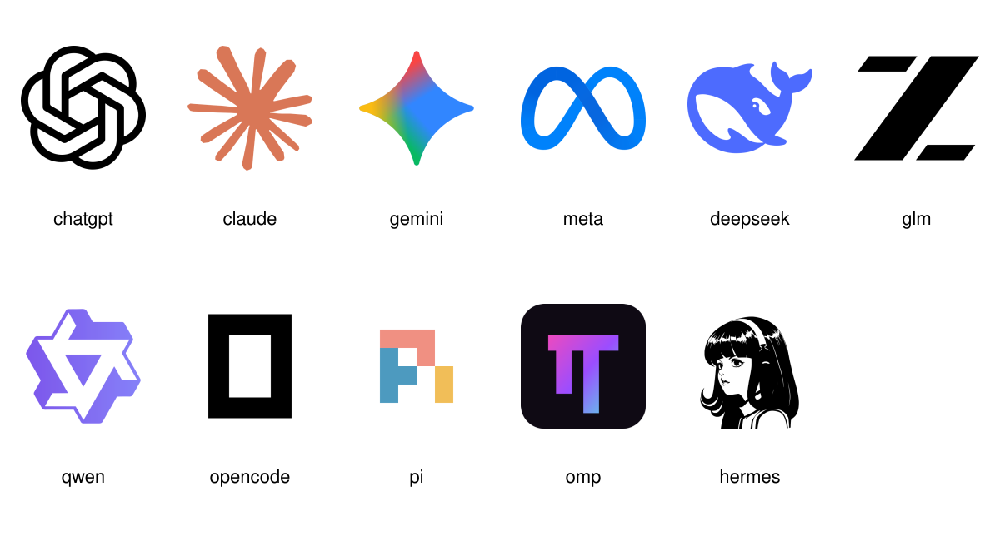

# Workshop logos

Collected 2026-10-20. SVG originals and transparent 512 x 512 PNG exports. The preview uses a white background; monochrome black marks need a light slide area.

| Product / model family | Vector | Transparent raster |
| --- | --- | --- |
| ChatGPT | [SVG](chatgpt.svg) | [PNG](chatgpt.png) |
| Claude | [SVG](claude.svg) | [PNG](claude.png) |
| Gemini | [SVG](gemini.svg) | [PNG](gemini.png) |
| Muse model / Meta | [SVG](meta.svg) | [PNG](meta.png) |
| DeepSeek | [SVG](deepseek.svg) | [PNG](deepseek.png) |
| GLM / Z.ai | [SVG](glm.svg) | [PNG](glm.png) |
| Qwen | [SVG](qwen.svg) | [PNG](qwen.png) |
| OpenCode | [SVG](opencode.svg) | [PNG](opencode.png) |
| Pi | [SVG](pi.svg) | [PNG](pi.png) |
| OMP | [SVG](omp.svg) | [PNG](omp.png) |
| Hermes Agent | [SVG](hermes.svg) | [PNG](hermes.png) |

## Sources

Common model-family marks and OpenCode come from [Lobe Icons](https://github.com/lobehub/lobe-icons/tree/8a1b2821bb768c484fe8da20c5e1838b6bf551a9/packages/static-svg/icons). The pack's MIT licence is retained in [LOBE-ICONS-LICENSE.txt](LOBE-ICONS-LICENSE.txt). Brand marks retain their respective owners' trademark rights.

| Local asset | Original source |
| --- | --- |
| chatgpt.svg | Lobe Icons openai.svg, OpenAI/ChatGPT blossom |
| claude.svg | Lobe Icons claude-color.svg |
| gemini.svg | Lobe Icons gemini-color.svg |
| meta.svg | Lobe Icons meta-color.svg |
| deepseek.svg | Lobe Icons deepseek-color.svg |
| glm.svg | Lobe Icons zai.svg, current Z.ai mark |
| qwen.svg | Lobe Icons qwen-color.svg |
| opencode.svg | Lobe Icons opencode.svg; [official brand page](https://opencode.ai/brand) |
| pi.svg | [Official Pi press kit](https://pi.dev/press-kit), [original SVG](https://pi.dev/logo-auto.svg) |
| omp.svg | [Official OMP repository favicon](https://github.com/can1357/oh-my-pi/blob/main/packages/collab-web/public/favicon.svg) |
| hermes.svg | [Official Hermes Agent repository icon](https://github.com/NousResearch/hermes-agent/blob/main/assets/icon-master.svg) |

## Naming

Meta is the requested substitute for the Muse model. Meta's documentation calls the underlying model Muse Spark and calls the coding agent Muse Code. No Muse Code agent mark is used here.

Pi is the coding harness from pi.dev, not Inflection's chatbot. OMP is Oh My Pi. Hermes uses the icon supplied in the Hermes Agent repository.

The older ChatGLM mark is available as [SVG](glm-legacy-chatglm.svg) and [PNG](glm-legacy-chatglm.png), separately from the current Z.ai mark.
