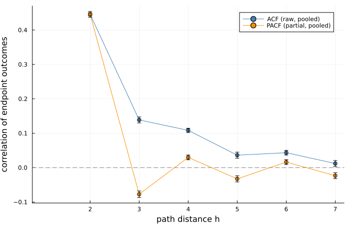
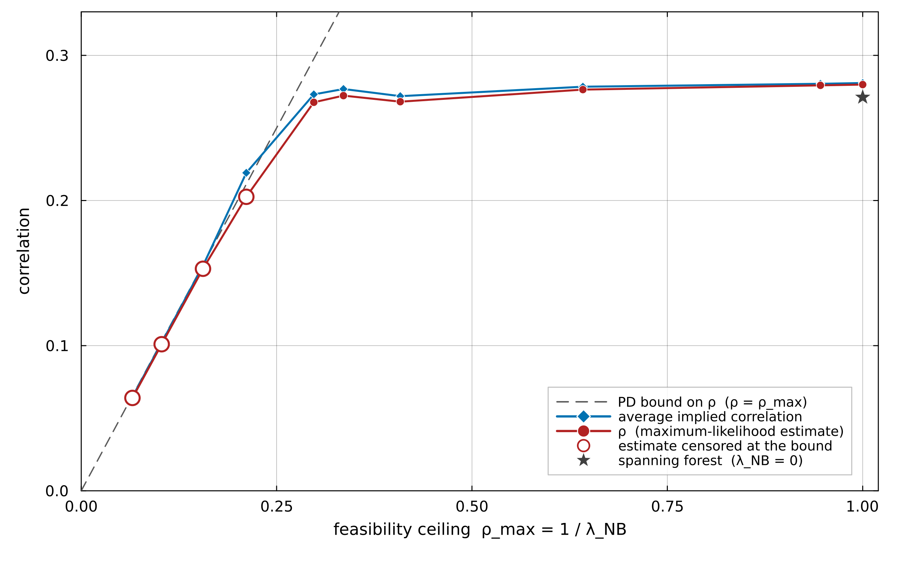
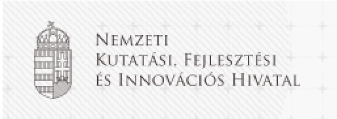
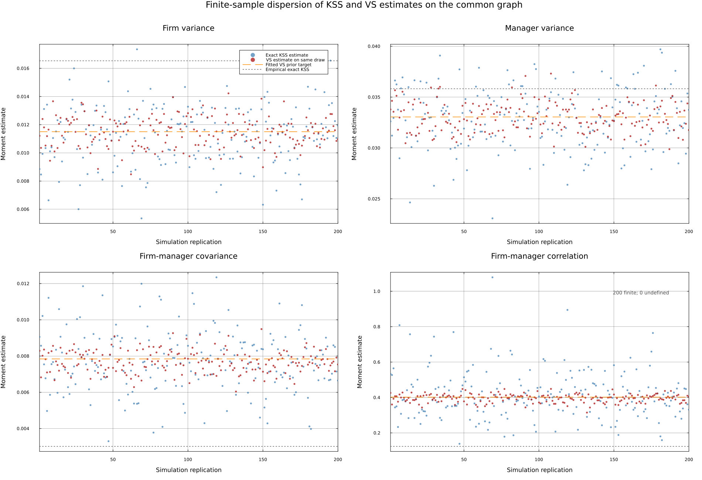
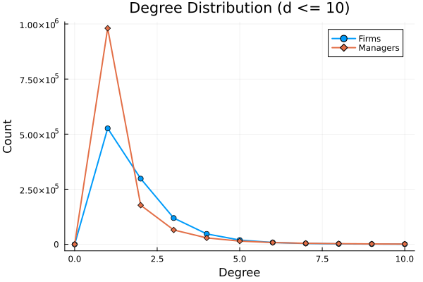
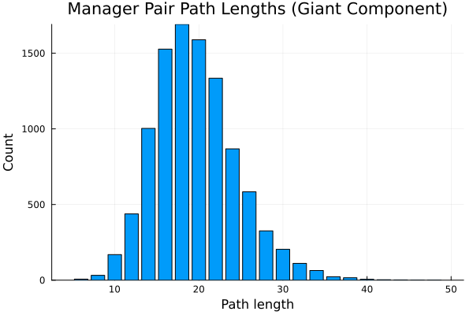
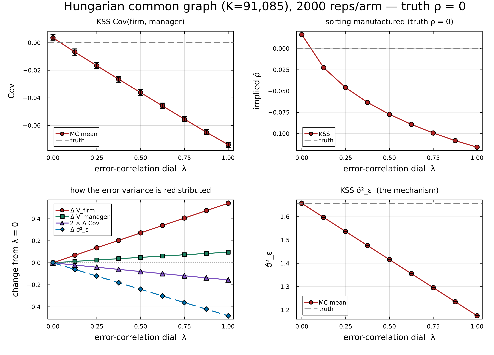

# Hálózatok: helyi hatások és globális szerkezet

## Hogyan hatnak ránk a szomszédaink?

Kollégiumi szobatársak hatása egymásra \smallcite{Sacerdote 2001}

Importálási tudás terjedése szomszédos vagy közös vezetővel működő vállalatok között \smallcite{Bisztray, Koren és Szeidl 2018}

Közvetlen szomszédok hatása; hosszabb láncok és alternatív utak.

Jackson: *Social and Economic Networks* (2008).

## Az egész hálózat szerkezete

Erdős--Rényi: véletlenszerű kapcsolatok \smallcite{Erdős és Rényi 1959}

Barabási--Albert: a nagy fokszámú csúcsok több új kapcsolatot vonzanak; széles fokszámeloszlás \smallcite{Barabási és Albert 1999}

Néhány paraméter, globális szabályszerűségek.

Olvasmány: Barabási Albert-László, *A hálózatok tudománya*.

## Csúcsok, élek, komponensek és körök

{width=85%}

Komponens: utakkal összekötött csúcsok.

Kör: visszatérés a kezdőpontba, él és közbülső csúcs ismétlése nélkül.

Fokszám: szomszédok száma; a 2. csúcsé 3.

## Kétféle csúcs: a páros gráf

{height=48%}

Élek csak a két csoport között.

Vállalat--vezető; vevő--termék; bank--hitelfelvevő.

## Ritka hálózat

Lehetséges kapcsolatok:

$N$ csúcs, egyszerű irányítatlan gráf: $N(N-1)/2$.

$N_f$ vállalat, $N_m$ vezető: $N_fN_m$.

Magyar adatok: $1.94\times10^6$ megfigyelt kapcsolat / $1.35\times10^{12}$ lehetséges pár.

## Néhány csúcsnak sokkal több szomszédja van

{height=53%}

Két szimulált hálózat, egyenként 200 csúcs.

Skálafüggetlen modell: a nagy fokszámok gyakorisága hatványfüggvény szerint csökken.

## Séta, út és távolság

{width=92%}

Séta: csúcsismétlés megengedett; egy él = egy lépés (hop).

Út: csúcsismétlés nélkül.

Távolság: a legrövidebb út hossza. Átmérő: a komponens legnagyobb távolsága.

## Amikor a kapcsolat iránya is számít

\begin{center}
\begin{tikzpicture}[>=stealth, every node/.style={circle,draw,minimum size=9mm},scale=1.1]
\node (a) at (0,0) {A};
\node (b) at (3,0) {B};
\node (c) at (6,0) {C};
\draw[->,very thick,CTred] (a) -- (b);
\draw[->,very thick,CTred] (b) -- (c);
\end{tikzpicture}
\end{center}

Bejövő és kimenő fokszám: ki fizet kinek?

Nálunk: irányítatlan gráf; egy vállalat--vezető pár = egy él, ismételt megbízatás esetén is.

## A mátrixhatványok sétákat számolnak

{height=44%}

$A_{ij}=1$, ha van él; egyébként 0.

$(A^k)_{ij}$: $k$ lépéses séták száma. Visszatérés is: $(A^2)_{22}=2$.

## Sajátértékek és mátrixhatványok

{height=53%}

12 csúcs, eltérő gráfok és sajátérték-eloszlások.

$$
A\mathbf v=\lambda\mathbf v
\quad\Rightarrow\quad
A^k\mathbf v=\lambda^k\mathbf v.
$$

Közösségkeresés a hálózati mátrix sajátértékeivel és sajátvektoraival.

# Miért számít a vezetők és a vállalatok párosítása?

## Számít-e az összkibocsátásban, hogy ki melyik vállalatot vezeti?

Koren, Wohak és Orbán: *Better Executives Work at Better Firms* (folyamatban).

Az erőforrások rossz elosztása csökkenti az aggregált termelékenységet \smallcite{Hsieh and Klenow 2009}

\pause

A vezetők döntései az egész vállalatra kihatnak.

A párosítás az egész gazdaság termelékenységét befolyásolja.

<!-- @8gx -->

## Jobb vezetők a jobb vállalatoknál

A vállalati termelékenység ($A_i$) és a vezetői képesség ($Z_m$) kiegészítik egymást:
$$
Y=\sum_{(i,m)\in\mathcal M} A_i Z_m.
$$

Rögzített peremeloszlások és párszám: a pozitív párosítás növeli a kibocsátást.

Mennyire erős ez a pozitív szelekció a vezetők és a vállalatok között?

## Ki melyik vállalatot vezeti?

\begin{center}
\begin{tikzpicture}[
  frm/.style={rectangle, draw=black!70, fill=black!8, thick, minimum size=6mm, inner sep=1pt, font=\scriptsize},
  mgr/.style={circle, draw=black!70, fill=white, thick, minimum size=6mm, inner sep=1pt, font=\scriptsize},
  lnk/.style={dashed, black!60, thick},
  scale=0.82, every node/.style={transform shape}
]
\node[font=\small\bfseries] at (0,0.9) {vállalatok, rangsorban};
\node[font=\small\bfseries] at (6,0.9) {vezetők, rangsorban};
\foreach \r in {1,...,8} {
  \node[frm] (a\r) at (0,-0.72*\r) {$A_{\r}$};
  \node[mgr] (z\r) at (6,-0.72*\r) {$Z_{\r}$};
}
\draw[lnk] (a1) -- (z2);
\draw[lnk] (a2) -- (z1);
\draw[lnk] (a3) -- (z3);
\draw[lnk] (a4) -- (z6);
\draw[lnk] (a5) -- (z4);
\draw[lnk] (a6) -- (z5);
\draw[lnk] (a7) -- (z8);
\draw[lnk] (a8) -- (z7);
\end{tikzpicture}
\end{center}

Milyen messze van a gazdaság a tökéletes pozitív párosítástól?

## Módszer ritka mobilitási hálózatokra

Mobilitási láncok mentén együtt mozgó vállalati teljesítmények.

A hálózati modellben a kovariancia lecsengési üteme azonosítja a szelekciót.

Magyarország: becsült korreláció **0.5**; véletlen párosítással **12.3%-kal** kisebb várható árbevétel.

# A vezetők ritka mobilitási hálózata

## A magyar vállalatvezetők mobilitási hálózata, 1990-2022

Vállalat--vezető kapcsolatok; teljesítmény vezetői időszakonként.

| . | Érték |
|---|---|
| Vezetők | 1,300,885 |
| Vállalatok | 1,036,230 |
| Egyedi vállalat--vezető kapcsolatok | 1,936,933 |
| **Kapcsolatok az óriáskomponensben** | **828,549 (42.8%)** |
| Összefüggő komponensek | 511,418 |
| **Hidak aránya az élek között** | **81.7%** |
| Átlagos vezetőtávolság az óriáskomponensben | 19.6 |

## A teljes vállalati körhöz a kis komponensek is hozzátartoznak

Cégnyilvántartás + a kettős könyvvitelt vezető vállalatok éves beszámolói.

Egy él: egyedi vállalat--vezető pár. Egy teljesítményadat: változatlan vezetői csapat.

Az óriáskomponensben: a vállalatok **33.2%-a**, a vezetők **29.8%-a**.

## A fixhatásos becsléshez összekötő utak kellenek

Fix hatások: komponensenként külön normalizálás.

Leave-out korrekció: az elhagyott megfigyelés után is becsülhető hatások.

Vezetői hálózatok: sok kis komponens és híd. \smallcite{Abowd, Kramarz and Margolis 1999; Kline, Saggio and Sølvsten 2020}

## A leave-out becslés minden tizedik párt tartja meg

Kiinduló minta: teljesítményadattal rendelkező párok.

| Lépés | Párok száma | % |
|:---|---:|---:|
| Összes egyedi vállalat--vezető pár | 1,732,154 | 100.0% |
| Hidak elhagyása (leverage $=1$) | 265,995 | 15.4% |
| Legnagyobb leave-out-összefüggő blokk | 175,661 | **10.1%** |

# A szelekció mérése mobilitási láncok mentén

## A vállalati teljesítmény legegyszerűbb modellje

A vállalat teljesítménye az $m$ vezető irányítása alatt:
$$
y_{im}=a_i+z_m+\varepsilon_{im}.
$$

$a_i$: vállalati adottságok; $z_m$: vezetői képesség. A teljesítményből becsüljük őket.

## Egy lánc különböző vállalatok teljesítményét kapcsolja össze

$$
m_1-i_1-m_2-i_2
$$

$m_2$ átveszi $m_1$ helyét az $i_1$ vállalatnál, majd az $i_2$ vállalatot vezeti.

$y_{i_1m_1}$ és $y_{i_2m_2}$: különböző vállalatok, különböző vezetők.

Pozitív szelekció: együtt mozgó tartós teljesítmény.

## A szelekcióból eredő kovariancia

\begin{center}
\begin{tikzpicture}[
  mgr/.style={circle, draw=black!70, fill=white, thick, minimum size=7mm, inner sep=0pt, font=\scriptsize},
  frm/.style={rectangle, draw=black!70, fill=black!8, thick, minimum size=7mm, inner sep=0pt, font=\scriptsize},
  ed/.style={draw=black!50, thick},
  hi/.style={draw=CTred, very thick},
  scale=0.9, every node/.style={transform shape}
]
\node[mgr] (m1) at (0,0) {$m_1$};
\node[frm] (i1) at (2,0) {$i_1$};
\node[mgr] (m2) at (4,0) {$m_2$};
\node[frm] (i2) at (6,0) {$i_2$};
\draw[hi] (m1) -- (i1);
\draw[ed] (i1) -- (m2);
\draw[hi] (m2) -- (i2);
\node[font=\scriptsize, anchor=north] at (1,-0.5) {teljesítmény $y_{i_1 m_1}$};
\node[font=\scriptsize, anchor=north] at (5,-0.5) {teljesítmény $y_{i_2 m_2}$};
\end{tikzpicture}
\end{center}

Az $m_1$ és $i_2$ végpontokat $h=3$ él választja el. Különböző vállalatok teljesítményét kapcsoljuk össze.

A szelekcióból eredő kovariancia:
$$
\rho(\sigma_a+\rho\sigma_z)(\sigma_z+\rho\sigma_a).
$$

## A kovariancia lecseng a mobilitási fa mentén

Ha a végpontokat $h$ él választja el:
$$
\begin{aligned}
\mathrm{Cov}(P-F-...-F-P) &= \rho^{\,h-2}\,(\sigma_a + \rho\sigma_z)^2\\
\mathrm{Cov}(F-P-...-P-F) &= \rho^{\,h-2}\,(\rho\sigma_a + \sigma_z)^2\\
\mathrm{Cov}(P-F-...-P-F) &= \rho^{\,h-2}\,(\sigma_a + \rho\sigma_z)(\rho\sigma_a + \sigma_z)
\end{aligned}
$$

A kovariancia **szintje** a $\sigma_a$, $\sigma_z$ és $\rho$ paraméterektől együttesen függ.

Két további lépés $\rho^2$-szeresére csökkenti a kovarianciát.

## Mit azonosít a lecsengés üteme?

Azonos típusú végpontok, két további él: a kovariancia $\rho^2$-szeres.

$|\rho|$: a lecsengés üteméből, a skálaparaméterektől függetlenül.

Előjel: vegyes végpontú utak momentumaiból és az együttes likelihoodból.

Fán: a fenti képletek. Körök mellett: a tényleges hálózat kovarianciája.

## A kovariancia lecsengése a magyar adatokban

{ height=75% }

## A tartós különbségek elkülönítése az üzleti sokkoktól

Feltevés: a sokkok különböző vállalatok között függetlenek.

Vállalaton belüli korreláció:

Minimumtávolság: különböző vállalatok kovarianciái.

Vállalati átlagok: tetszőleges vállalaton belüli sokkkovariancia.

AR(1) likelihood: sokkperzisztencia becslése a vezetői időszakok között.

# Ritka gráfokon is működő modell

## A teljes hálózat modellje

A vállalati és vezetői látens típusok együttes eloszlása:
$$
\mathbf x \sim \mathcal N(\mathbf 0,\mathbf Q^{-1}).
$$

Ritka $\mathbf Q$: feltételes függés a szomszédok között; nulla a hiányzó éleknél.

**Gauss-féle Markov-mező** (GMRF) \smallcite{Rue and Held 2005}.

## Az ismerős példa: AR(1) folyamat

Az $x_t = \rho x_{t-1} + u_t$ folyamat egy láncgráfon:
$$
\mathbf{Q} \propto
\begin{bmatrix}
1 & -\rho &  &  \\
-\rho & 1+\rho^2 & -\rho &  \\
  & -\rho & 1+\rho^2 & -\rho \\
  &  & -\rho & 1
\end{bmatrix}
$$

## Ritka precíziós mátrix, sűrű kovarianciamátrix

Az AR(1) folyamat mozgóátlag-reprezentációjához sűrű kovarianciamátrix tartozik:
$$
\mathbf \Sigma = \mathbf{Q}^{-1} \propto
\begin{bmatrix}
1 & \rho & \rho^2 & \rho^3 \\
\rho & 1 & \rho & \rho^2 \\
\rho^2 & \rho & 1 & \rho \\
\rho^3 & \rho^2 & \rho & 1
\end{bmatrix}
$$

Parciális korreláció csak a szomszédok között van. A feltétel nélküli autokorreláció $d$ késleltetésnél: $\rho^d$.

## Erdőkön a paraméterek közvetlenül értelmezhetők

Erdőn:
$$
\operatorname{Cov}(x_k,x_\ell)=\sigma_k\sigma_\ell\rho^{d(k,\ell)}.
$$

Erdőn: $\operatorname{Var}(a)=\sigma_a^2$, $\operatorname{Var}(z)=\sigma_z^2$; szomszédok korrelációja $\rho$.

Körök mellett a momentumokat $\mathbf Q^{-1}$ adja.

## Becslés az összes megtartott komponens felhasználásával

A típusok együttes eloszlását becsüljük: normális likelihood, ritka mátrixfaktorizáció.

Önálló pár: a teljesítmény teljes szóródása.

Hosszabb láncok: a kovariancia lecsengése.

A kovarianciamodell érvényességéhez kört záró éleket ritkítunk. Minden csúcs és komponens megmarad.

## Hogyan szerepel a teljesítmény a becslésben?

Az $i$ vállalat $g$ időszakában az $M_g$ vezetői csapat változatlan:
$$
y_g=a_i+\frac{1}{|M_g|}\sum_{m\in M_g}z_m+\varepsilon_g.
$$

Időszakonként egy teljesítményadat és hibatag, több vezető esetén is.

Négy szelekciós és skálaparaméter + vállalaton belüli perzisztencia ($\eta$).

# Becslések és robusztusság

## Erős a pozitív szelekció: $\rho \approx 0.52$--$0.54$

Log reálárbevétel, év--ágazat átlagoktól tisztítva. AR(1): a tanulmány fő becslése.

| Paraméter | Naiv MLE | Min. távolság | Vállalati átlag | AR(1) MLE |
|:---|---:|---:|---:|---:|
| $\rho$ | 0.379 | 0.542 | 0.536 | **0.518** |
| Modell szerinti korr. $(a,z)$ | 0.381 | 0.549 | 0.543 | 0.525 |

## Mit jelent a $\rho\approx0.52$ érték?

Standardizált típusok korrelációja a ritkított, faszerű hálózaton:
$$
\rho^d
$$
ahol $d$ a hálózati távolság.

Közvetlen szomszédok: $0.52$. Két lépésre: $0.27$. Négy lépésre: $0.07$.

## A kis komponensekkel több vállalatot érünk el

**426,000 kisebb komponens**: közel kétszer annyi csúcs, **59%-kal** több él.

Két módszer, többféle ritkítás: $\rho$ változása legfeljebb **0.011**.

Mintabővítési összehasonlítás: év--ágazat átlagok és fokszámok kiszűrve; a fő AR(1)-becsléstől külön.

## Az óriáskomponens vállalatai nagyobbak

| | Óriáskomponens | Többi |
|:---|---:|---:|
| Átlagos létszám | 9.1 | 3.5 |
| Átlagos logárbevétel | 9.37 | 8.65 |
| Feldolgozóipar | 8.6\% | 9.5\% |
| Alapító által vezetett | 46.9\% | 72.2\% |

<!-- @(redo Table 2 in paper.tex for leave-out sample) -->

## A teljesítmény parciális korrelációja a láncok mentén

**432,114** izolált legrövidebb út; a közbülső teljesítmények kiszűrése után:
$$
|\mathrm{PACF}|\leq 0.08 \qquad (h\geq3).
$$

A diagnosztikát a megfigyelt teljesítményekre számítjuk.

## Különálló komponensek: kis negatív kovariancia

A GMRF szerint a különálló komponensek között pontosan nulla a kovariancia.

| Mutató | Becslés |
|:---|---:|
| Külön komponensekből vett párok | 58,785 |
| Kovariancia (standard hiba) | $-0.0629$ $(0.0208)$ |
| Korreláció | $\approx -0.013$ |
| Statisztikai próba | $\chi^2(10)=21.38$, $p=0.0186$ |

A nullát elutasítjuk; kicsi, negatív kovariancia. Közös tényező: pozitív korrelációt várnánk.

# Gazdasági jelentőség

## A szelekció érdemben hozzájárul az árbevétel szóródásához

AR(1)-becslés; a 2022-es aktív kapcsolatok feszítőerdője.

| Összetevő | Részarány |
|:---|---:|
| Vállalati hatások | 26.2% |
| Vezetői hatások | 1.2% |
| Szelekciós kovariancia | **5.9%** |
| Párospecifikus zaj (vállalaton belül korrelált) | 66.7% |

## Mennyit ér a szelekció?

Rögzítjük:

a vállalati adottságok és a vezetői képesség peremeloszlását;

a párospecifikus zaj szórását;

a párok számát.

A vállalatokat és vezetőket újrapárosítjuk.

Parciális egyensúly, AR(1)-becslés; a 2022-es kapcsolatok feszítőerdője.

## Három alternatív párosítás

Alaphelyzet: $\ln E[R]=1.799$.

| Forgatókönyv | Várható árbevétel változása |
|:---|---:|
| Véletlen párosítás ($\rho = 0$) | $-12.3\%$ |
| Képességszórás megszüntetése, átlagmegőrzéssel ($\sigma_z \to 0$) | $-12.3\%$ |
| Tökéletes pozitív párosítás ($\rho = 1$) | $\approx +13.2\%$ |

<!-- @lj9 -->

A tökéletes pozitív párosítás elméleti felső korlát.

## Hogyan értelmezzük a számítást?

Rögzített peremeloszlások és párospecifikus sokkok.

Lognormális modell: a vizsgált vállalatok várható árbevétele.

# Új kérdés: közbeszerzések és vállalati hálózatok

## Mennyibe kerül valójában egy autópálya vagy egy vasúti híd?

Az $i$ ajánlatkérő a $t$ tendert írja ki; a $j$ cég ajánlatot tesz.

Lehetséges kiindulópont: tartós érték- és költségkülönbségek, tenderenkénti eltérésekkel.
$$
v_{it}=v_i+\varepsilon^v_{it},
\qquad
c_{jt}=c_j+\varepsilon^c_{jt}.
$$

Az árat, $p_{ijt}$-t látjuk; az értéket és a költséget jellemzően nem. Kevés az összehasonlítható ügylet.

Milyen függetlenségi feltevések lennének hihetők az eltérésekre?

## Az ár és a társadalmi többlet két külön kérdés

Egy egyszerű, önkéntes szerződésben: $c_{jt}\leq p_{ijt}\leq v_{it}$.
$$
\begin{aligned}
\text{Vevő nyeresége:}\quad & v_{it}-p_{ijt},\\
\text{Eladó nyeresége:}\quad & p_{ijt}-c_{jt},\\
\text{Együttes többlet:}\quad & v_{it}-c_{jt}.
\end{aligned}
$$

Az ár a többlet megosztásától is függ. A társadalmi kérdés: azok a párok szerződnek-e, amelyeknél nagy a többlet?

Magasabb költség vagy nagyobb árrés? Az árból önmagában nem válik szét.

## Ki dönt arról, hogy létrejön-e a szerződés?

Átruházható hasznosság mellett az ár transzfer: az egyik fél kiadása a másik bevétele. Az együttes többletből kiesik. \smallcite{Choo és Siow 2006}

Mi változik, ha a döntéshozó nem a közösség $v_{it}-p_{ijt}$ nyereségét követi, például magánelőnyhöz jut?

Lehetséges elméleti kiindulópont: párosítás tökéletlenül átruházható hasznossággal. \smallcite{Galichon, Kominers és Weber 2019}

Ehhez még meg kellene fogalmazni az ajánlattétel és az elfogadás szabályát.

## Mit tehetne hozzá a hálózat?

Ajánlatkérő--cég kapcsolatok; esetleg a cégek egymás közötti kapcsolatai.

Mutatnak-e ezek tartós együttmozgást a költségekben, az árrésekben vagy a szerződések létrejöttében?

Ha igen, segíthetne-e egy ritka hálózati modell elkülöníteni a tartós különbségeket a tenderenkénti eltérésektől?

Egyelőre modellötlet: a hálózat, az árképzés és az azonosítás még kidolgozandó.

# Következtetések

## A szelekció mérése ritka hálózatokon

Szelekció: a kovariancia lecsengése a mobilitási láncok mentén.

Ritka Gauss-modell: minden megtartott komponens felhasználása.

Magyarország: erős pozitív szelekció; véletlen párosítással **12.3%-kal** kisebb várható árbevétel.

Sűrű hálózatokon összevetés a leave-out módszerekkel.

## További ritka hálózatok látens típusokkal

Példák: vevő--beszállító hálózatok és nemzetközi kereskedelem.

Páros és általános gráfokon is alkalmazható.

# Függelék

## A vezetők és a vállalatok párosításának egyszerű modellje

Az $i$ vállalat az $L$ munkát két rögzített tényezővel kombinálja: az $A_i$ termelékenységgel és a vezető $Z_m$ képességével \smallcite{Lucas 1978}.
A $w$ bér mellett a profitot maximalizáló létszámot választja:
$$
\pi_{im}=\max_L\left\{A_i Z_m^{\nu}L^{1-\nu}-wL\right\}.
$$
Az optimális létszám mellett az árbevétel a *két rögzített tényező* Cobb--Douglas-függvénye:
$$
Y_{im}=c(w)A_i^{1/\nu}Z_m.
$$

## A pozitív szelekció növeli a várható kibocsátást

Ha $a=\ln A/\nu + \ln c(w)$ és $z=\ln Z$ együttes eloszlása normális, a páronkénti várható árbevétel:
$$
\mathbb E[Y_{im}]
=\exp\Big\{\mu_a+\mu_z+\tfrac12\big(\sigma_a^2+\sigma_z^2\big)+\operatorname{Cov}(a,z)\Big\}.
$$

Rögzített peremeloszlások mellett a várható összárbevétel nő a $\operatorname{Cov}(a,z)$ kovarianciával.

## Hogyan mérhetjük a vezetői képességet?

Kérdőívek és naplók rögzítik, mivel foglalkoznak a vezetők \smallcite{Bandiera et al 2020}

A végzettség, a tapasztalat és a vezetési stílus megfigyelhető közelítő mutatók.

A vállalatváltások segítenek elkülöníteni a vezetők tartós hozzájárulását \smallcite{Bertrand and Schoar 2003, Abowd, Kramarz and Margolis 1999}

## A vezetőváltások megmutatják a képességkülönbségeket

A vezetői képességet a vállalaton belüli vezetőváltásokból mérjük: $\Delta\widehat{z}_m \approx \Delta y_{im}$.

Az $a_i$ és $z_m$ hatásokat *paraméterként* kezeljük, és vállalati, illetve vezetői indikátorváltozókkal OLS-becslést végzünk.

Munkavállalók: \smallcite{Abowd, Kramarz and Margolis 1999; Andrews et al 2008; Kline, Saggio and Sølvsten 2020}. Vállalatvezetők: \smallcite{Bertrand and Schoar 2003; Fenizia 2022; Metcalfe, Sollaci and Syverson 2023}

## 1. probléma: a fix hatásokhoz összefüggő komponens kell

A vállalati és vezetői hatásokat komponensenként külön normalizálással azonosítjuk.

A becsült hatások szintjét az adott komponens normalizálásához viszonyítjuk.

A szokásos becslési minta a legnagyobb komponens.

## 2. probléma: a zaj torzítja a második momentumokat

A $\varepsilon$ hibatag zajossá teszi a becsült hatásokat.

A második momentumok becslése torzított:
$\widehat{\mathrm{Var}}$ túl nagy, $\widehat{\mathrm{Cov}}$ túl kicsi \smallcite{Andrews et al 2008; Kline, Saggio and Sølvsten 2020; Koren, Orbán and Telegdy 2025}

A kevés vállalatváltás mindkét problémát súlyosbítja.

## Fák, erdők, körök és hidak

\begin{center}
\begin{tikzpicture}[
  nd/.style={circle, draw=black!70, fill=white, thick, minimum size=4.5mm, inner sep=0pt},
  ed/.style={draw=black!50, thick},
  brd/.style={draw=CTred, very thick},
  cyc/.style={draw=blue!60!black, very thick},
  lab/.style={font=\scriptsize\bfseries, align=center},
  scale=0.8, every node/.style={transform shape}
]
\node[lab] at (0,1.1) {fa:\\ nincs kör};
\node[nd] (t1) at (0,0) {};
\node[nd] (t2) at (-0.8,-1) {};
\node[nd] (t3) at (0.8,-1) {};
\node[nd] (t4) at (-1.3,-2) {};
\node[nd] (t5) at (-0.3,-2) {};
\draw[brd] (t1) -- (t2); \draw[brd] (t1) -- (t3);
\draw[brd] (t2) -- (t4); \draw[brd] (t2) -- (t5);
\node[lab] at (3.6,1.1) {erdő:\\ különálló fák};
\node[nd] (f1) at (3.1,0) {};
\node[nd] (f2) at (3.1,-1) {};
\draw[brd] (f1) -- (f2);
\node[nd] (f3) at (4.1,-0.5) {};
\node[nd] (f4) at (4.1,-1.5) {};
\node[nd] (f5) at (4.7,-0.9) {};
\draw[brd] (f3) -- (f4); \draw[brd] (f3) -- (f5);
\node[lab] at (7.2,1.1) {kör:\\ több út a csúcsok között};
\node[nd] (c1) at (6.6,-0.2) {};
\node[nd] (c2) at (7.8,-0.2) {};
\node[nd] (c3) at (7.8,-1.4) {};
\node[nd] (c4) at (6.6,-1.4) {};
\draw[cyc] (c1) -- (c2) -- (c3) -- (c4) -- (c1);
\node[lab] at (11.4,1.1) {híd:\\ elhagyása szétszakít};
\node[nd] (b1) at (10.2,-0.2) {};
\node[nd] (b2) at (10.2,-1.4) {};
\node[nd] (b3) at (10.9,-0.8) {};
\node[nd] (b4) at (11.9,-0.8) {};
\node[nd] (b5) at (12.6,-0.2) {};
\node[nd] (b6) at (12.6,-1.4) {};
\draw[cyc] (b1) -- (b2) -- (b3) -- (b1);
\draw[cyc] (b4) -- (b5) -- (b6) -- (b4);
\draw[brd] (b3) -- (b4);
\end{tikzpicture}
\end{center}

A **híd** olyan él, amelynek elhagyása szétszakít egy összefüggő komponenst.

Egy fában *minden* él híd.

## A leave-out korrekciókhoz körök kellenek

\begin{center}
\begin{tikzpicture}[
  mgr/.style={circle, draw=black!70, fill=white, thick, minimum size=5mm, inner sep=0pt, font=\tiny},
  frm/.style={rectangle, draw=black!70, fill=black!8, thick, minimum size=5mm, inner sep=0pt, font=\tiny},
  brd/.style={draw=CTred, very thick},
  keep/.style={draw=blue!60!black, very thick},
  scale=0.9, every node/.style={transform shape}
]
\node[mgr] (m1) at (0,0) {};
\node[frm] (f1) at (1.5,0.6) {};
\node[frm] (f2) at (1.5,-0.6) {};
\node[mgr] (m2) at (3,0) {};
\node[frm] (f3) at (4.5,0.8) {};
\node[mgr] (m3) at (6,0.8) {};
\node[frm] (f4) at (4.5,-0.8) {};
\node[mgr] (m4) at (6,-0.8) {};
\node[frm] (f5) at (7.5,-0.8) {};
\node[mgr] (m5) at (9,-0.4) {};
\node[mgr] (m6) at (9,-1.4) {};
\draw[keep] (m1) -- (f1) -- (m2) -- (f2) -- (m1);
\draw[brd] (m2) -- (f3);
\draw[brd] (f3) -- (m3);
\draw[brd] (m2) -- (f4);
\draw[brd] (f4) -- (m4);
\draw[brd] (m4) -- (f5);
\draw[brd] (f5) -- (m5);
\draw[brd] (f5) -- (m6);
\node[font=\scriptsize, blue!60!black, anchor=west] at (0,-1.9) {\textbf{kék}: körön van, leverage $<1$ --- használható};
\node[font=\scriptsize, CTred, anchor=west] at (0,-2.4) {\textbf{piros}: híd, leverage $=1$ --- elhagyjuk};
\end{tikzpicture}
\end{center}

A négyzetek vállalatok, a körök vezetők, az élek vezetői megbízatások.

## Szelekció egyetlen élen

Egy önálló élre, a fa építőelemére:
$$
\begin{pmatrix}a_i\\z_m\end{pmatrix}
\sim \mathcal N\!\left(
\mathbf 0,
\begin{bmatrix}
\sigma_a^2 & \rho\sigma_a\sigma_z\\
\rho\sigma_a\sigma_z & \sigma_z^2
\end{bmatrix}
\right).
$$

Itt $\rho$ az él két végén álló típusok korrelációja.

## Négy paraméter írja le a szelekciót

$$
\boldsymbol\theta
=\left(\sigma_a,\ \sigma_z,\ \rho,\ \sigma_\varepsilon\right),
\qquad
\varepsilon_{im}\sim\mathcal N(0,\sigma_\varepsilon^2).
$$

A szelekciót $\rho$ méri. A három skálaparaméter a vállalatok, a vezetők és a párok közötti heterogenitást írja le.

## A korreláció lecsengése a családfán

Clark a legtöbb rokoni kapcsolatra a következő összefüggést írja fel \smallcite{Fisher 1918; Gimelfarb 1981; Clark 2023}
$$
\rho_n = h^2 b^n,
\qquad
b=\frac{1+m}{2}.
$$

Itt $\rho_n$ az $n$ rokonsági távolsághoz tartozó státuszkorreláció, $h^2$ az örökölhetőség, $m$ pedig a házastársak genetikai értékei közötti korreláció.

## Mi a helyzet a vállalaton belüli, időben korrelált sokkokkal?

Időben független, azonos eloszlású $\varepsilon_{im}$ mellett:
$$
\mathrm{Cov}(P-F-P) = (\sigma_a + \rho\sigma_z)^2
$$

Autokorrelált sokkok mellett a mért kovariancia felfelé torzít.

A közös sokkok hatása **helyi**. A szelekciót a kovariancia **hosszú láncok menti lecsengésének üteme** azonosítja.

## Párosítás előtt a típusok függetlenek

A kapcsolatok létrejötte előtt:
$$
a_i\sim\mathcal N(0,\omega_a^2),
\qquad
z_m\sim\mathcal N(0,\omega_z^2).
$$

A kapcsolódó vállalatok és vezetők közötti korreláció így a párok kiválasztódásából ered.

## Létrejön-e a kapcsolat? Két kifizetés

$$
\begin{aligned}
\text{kapcsolat:}\quad
& \kappa + \frac{a_i z_m}{\tau}, \\
\text{nincs kapcsolat:}\quad
& \frac{1}{\tau}\left(
\alpha_1a_i+\zeta_1z_m
+\frac{\alpha_2}{2}a_i^2+\frac{\zeta_2}{2}z_m^2
\right).
\end{aligned}
$$

A $\tau>0$ paraméter a párosítást nehezítő súrlódások mértékét adja meg. Az $a_i z_m$ tag komplementerré teszi a vállalati és vezetői típust. A lineáris és négyzetes tagok miatt a külső lehetőségek is típusfüggők.

## A különbségük adja a logitindexet

Vezessük be a következő jelölést:
$$
\eta(a_i,z_m)
:= \kappa+\frac{1}{\tau}
\left[
a_i z_m-\alpha_1a_i-\zeta_1z_m
-\frac{\alpha_2}{2}a_i^2-\frac{\zeta_2}{2}z_m^2
\right].
$$

A két állapot valószínűsége:
$$
\Pr(L_{im}=1\mid a_i,z_m)=\frac{e^\eta}{1+e^\eta},
\qquad
\Pr(L_{im}=0\mid a_i,z_m)=\frac{1}{1+e^\eta}.
$$

## A megfigyelt hálózat likelihoodja

A típusok és kapcsolatok együttes sűrűsége: a prior szorozva minden létrejött és elmaradt kapcsolat valószínűségével:
$$
p(\mathbf x, E) \propto p_0(\mathbf x)
\prod_{(i,m)\in E}\Pr(L_{im}{=}1\mid \mathbf x)
\prod_{(i,m)\notin E}\Pr(L_{im}{=}0\mid \mathbf x)
$$

A kapcsolatok ritkák. Ha $e^{\eta}$ kicsi:
$$
\Pr(L_{im}=1\mid a_i,z_m)\simeq e^{\eta(a_i,z_m)}
\qquad\text{az elmaradt kapcsolatok kiesnek.}
$$

A **ritka kapcsolatok közelítésében** a létrejött kapcsolatok tényezőit használjuk.

## Az így kapott eloszlás pontosan a GMRF-modellünk

Minden megfigyelt kapcsolat egy másodfokú tagot ad a kitevőhöz:
$$
p_E^+(\mathbf x)
\propto p_0(\mathbf x)\prod_{(i,m)\in E}e^{\eta(a_i,z_m)}
\propto \exp\Big(-\frac12\mathbf x^\top\mathbf Q\mathbf x + \mathbf b^\top\mathbf x\Big)
$$

\begingroup
\small

$$
\mathbf Q = \underbrace{\mathbf Q_0}_{\text{független prior}}
+ \underbrace{\frac{1}{\tau}\,\mathbf C \mathbf D}_{\text{ismételt szelekció}}
- \underbrace{\frac{1}{\tau}\,\mathbf A}_{\text{komplementaritás}}
\;=\; \frac{1}{1-\rho^2}\mathbf S\left[(1-\rho^2)\mathbf I+\rho^2\mathbf D-\rho\mathbf A\right]\mathbf S
$$

\endgroup

A $\tau = \sigma_a\sigma_z(1-\rho^2)/\rho$ választással a kapcsolatkeletkezési modell *pontosan előállítja* a varianciastabil precíziós mátrixot.

## Mikor érvényes a közelítés?

A ritka kapcsolatok közelítése elhagyja a közös logitnevezőket.

A közelítés ritka, erdőszerű hálózaton érvényes; a sűrű, sok kört tartalmazó részeken sérül.

Ezért a sűrű magból **elhagyunk néhány kört záró élt**, és a közel erdőszerű hálózaton becslünk. Minden csúcsot és komponenst megtartunk.

A KSS a körökre épít, mi a fákra támaszkodunk. Így az adatok túlnyomó részét meg tudjuk tartani.

## A likelihoodfüggvény

$$
\ell(\boldsymbol{\theta}) = -\frac{K}{2}\ln(2\pi) - \frac{1}{2}\ln\det\boldsymbol{\Omega} - \frac{1}{2}\mathbf{y}^\top\boldsymbol{\Omega}^{-1}\mathbf{y}
$$

$$
\boldsymbol{\Omega} = \mathbf{V}\mathbf{Q}^{-1}\mathbf{V}^\top + \sigma_\varepsilon^2\mathbf{R}
\qquad\text{($\mathbf V$ az éleket a típusokhoz rendeli)}
$$

$$
\mathbf Q=\frac{1}{1-\rho^2}\,\mathbf S
\left[(1-\rho^2)\mathbf I+\rho^2\mathbf D-\rho\mathbf A\right]
\mathbf S,
\qquad \mathbf S=\operatorname{diag}(\sigma_a^{-1}\mathbf I_{N_f},\,\sigma_z^{-1}\mathbf I_{N_m})
$$

$\mathbf A$ a szomszédsági mátrix, $\mathbf D$ a fokszámok diagonális mátrixa. Az éleken $\rho$, a diagonálison skálaparaméterek szerepelnek.

## Melyik becslést mikor használjuk?

| Hálózat | Becslés |
|:---|:---|
| Sűrű (sok vállalatváltás) | leave-out (KSS), kis adatveszteség |
| Ritka, erdőszerű | GMRF |
| Köztes eset | mindkettő, majd összehasonlítás |

A GMRF éppen a ritka hálózatoknál hasznos, ahol a leave-out korrekciók a legtöbb megfigyelést eldobják.

## A nyers korreláció fennmarad, a parciális eltűnik

{width=68%}

$h=2$ mellett az ACF és a PACF megegyezik. $h\geq3$ mellett a közbülső teljesítmények kiszűrése után a PACF közel nulla.

## A leave-one-out korrekció és a leverage

Kline, Saggio és Sølvsten (2020) minden hatást az $i$ megfigyelés *elhagyásával* becsülnek meg.

A fixhatás-becslések a teljesítményadatok lineáris függvényei. Az $i$ megfigyelés a saját illesztett értékében $h_i$ súllyal szerepel; ez a **leverage**. A torzításkorrekcióban az $1/(1-h_i)$ tényező szerepel.

Ha $h_i = 1$, a hatás *csak* az $i$ megfigyelésből becsülhető. Ezeket a megfigyeléseket el kell hagyni.

**$h_i = 1$ pontosan akkor, ha az $i$ él híd.**

## Az előnyben részesített AR(1) modell paraméterei

$$
\hat\sigma_a=1.08,\qquad
\hat\sigma_z=0.24,\qquad
\hat\sigma_\varepsilon=1.72,\qquad
\hat\eta=0.51.
$$

A korrelált párospecifikus sokk a tartós vállalaton belüli körülményeket ragadja meg.

## A precíziós mátrix egyetlen élen

Vegyünk egy önálló vállalat--vezető párt; mindkét csúcs fokszáma 1:
$$
\mathbf{Q}_{\{i,m\}} = \frac{1}{1-\rho^2}
\begin{bmatrix}
\sigma_a^{-2} & -\rho\,\sigma_a^{-1}\sigma_z^{-1} \\
-\rho\,\sigma_a^{-1}\sigma_z^{-1} & \sigma_z^{-2}
\end{bmatrix}
\;\Longleftrightarrow\;
\operatorname{Var}\begin{pmatrix} a_i \\ z_m \end{pmatrix} =
\begin{bmatrix}
\sigma_a^{2} & \rho\,\sigma_a\sigma_z \\
\rho\,\sigma_a\sigma_z & \sigma_z^{2}
\end{bmatrix}
$$

A $\mathbf{Q}$ főátlón kívüli elemei **csak a megfigyelt élek mentén** különböznek nullától.

Erdőn minden közvetlenül kapcsolódó pár korrelációja pontosan $\rho$.

## Mi az a Gauss-féle Markov-mező?

Együttesen normális eloszlású változók, **ritka precíziós mátrixszal**.

Nulla elem a $\mathbf{Q}$ mátrixban $\Leftrightarrow$ feltételes függetlenség az összes többi változó ismeretében.

A *feltételes* függés helyi: csak a közvetlen szomszédok között van.

A *feltétel nélküli* függés az utak mentén terjed.

## A kört záró éleket elhagyjuk, a komponenseket megtartjuk

{ height=72% }

<!-- @5bs -->

A kört záró élek ritkítása minden csúcsot és komponenst megtart.

<!-- @fnq -->

## Az alternatív párosítások számítási képlete

A páronkénti várható árbevétel a lognormális modellben:
$$
\frac{Y}{n} = \exp\left\{\mu_a+\mu_z+\mu_\varepsilon+\tfrac{1}{2}\big(V_a+V_z+V_\varepsilon+2\operatorname{Cov}(a,z)\big)\right\}
$$

A peremeloszlásokat rögzítjük, megváltoztatjuk a párosítást, majd kiszámítjuk a várható kibocsátás változását.

## Vezetői hatások a szakirodalomban

**Fenizia (2022)**: olasz közintézmények vezetői; AKM-becslés Andrews és szerzőtársai (2008) korrekciójával. A vezetők csupán 24%-a vált munkahelyet. A torzításkorrigált felbontás a megfigyelések 21%-át tartja meg, a legnagyobb összefüggő halmazt.

**Metcalfe, Sollaci és Syverson (2023)**: kiskereskedelmi vezetők, *negatív* becsült korreláció.

A zaj felfelé torzítja a becsült varianciákat, és negatív kovarianciát hoz létre a két becsült hatás között. Így a korreláció nullánál kisebb is lehet. A mechanizmust a függelék mutatja be.

## Kapcsolódó tanulmányaink

**Wohak és Koren (2025)**: leave-out becslés ritka gráfokon. A KSS és a GMRF a hálózat *más részeire* támaszkodik: a körökre, illetve a hidakra. A nagy leverage a hidakon kívül is zajossá teszi a második momentumok becslését. A zaj a nemnegativitási korlátokkal együtt torzítást okoz.

**Koren, Orbán és Telegdy (2025)**: a vezetők értéke. Idősoros becslés, amely kiszűri a vállalaton belüli hibakorrelációból eredő látszólagos előtrendeket. A korrekció után a vezetőváltások nem mutatnak kapcsolatot a korábbi teljesítménnyel ugyanebben a magyar adatbázisban.

## Köszönetnyilvánítás

::: columns
:::: column
{width=80%}
::::
:::: column
{width=80%}
::::
:::

A kutatást az Európai Kutatási Tanács (ERC Advanced Grant, 101097789. számú támogatási szerződés) és a Nemzeti Kutatási, Fejlesztési és Innovációs Hivatal (Élvonal Kutatási Kiválósági Program, 144193. számú szerződés) támogatta. Az előadásban kifejtett vélemények a szerzőké, és nem feltétlenül tükrözik az Európai Unió, az Európai Kutatási Tanács vagy az NKFI Hivatal hivatalos álláspontját.

## Miért lehet negatív a fix hatások becsült korrelációja?

A fixhatás-becslések a teljesítményadatok lineáris kombinációi, így a zajt is tartalmazzák.

Ha egy zajtag *pozitív* súllyal kerül a vállalati hatás becslésébe, ugyanannál a párnál *negatív* súllyal kerül a vezetői hatáséba: a két indikátorváltozó ugyanazt a változást osztja fel egymás között.

A túlbecsült varianciák nulla felé húzzák a korrelációt; a mechanikusan keletkező negatív kovariancia tovább csökkenti.

A szakirodalmi becslések alacsonyabbak, néha negatívak.

## A leave-out becslés ott is zajos, ahol alkalmazható

{ height=72% }

Szimulációk azonos hálózaton: a KSS másodikmomentum-becslései (kék) sokkal jobban szóródnak, mint a GMRF-becslések (piros).

## Modellilleszkedés: a logárbevétel varianciájának felbontása

A tanulmány AR(1)-becslése alapján, a 2022-ben aktív kapcsolatok feszítőerdőjére számítva:

| Összetevő | Részarány |
|:---|---:|
| Vállalati hatások | 26.2% |
| Vezetői hatások | 1.2% |
| Szelekciós kovariancia | 5.9% |
| Párospecifikus zaj (vállalaton belül korrelált) | 66.7% |

A szelekciós kovarianciatag körülbelül ötszöröse a vezetői komponensnek.

## A páros mobilitási gráf

{ width=48% } { width=48% }

Az élek 42.8%-a az óriáskomponensben van; a többi jórészt önálló vállalat--vezető párokhoz tartozik.

## Monte Carlo: korrelált hibák a magyar hálózaton

{ height=75% }

## Hálózati olvasmányok

[Sacerdote (2001), *Peer Effects with Random Assignment*](https://doi.org/10.1162/00335530151144131)

[Jackson (2008), *Social and Economic Networks*](https://press.princeton.edu/books/paperback/9780691148205/social-and-economic-networks)

[Bisztray, Koren and Szeidl (2018), *Learning to Import from Your Peers*](https://koren.mk/publications/import-spillovers)

[Erdős and Rényi (1959), *On Random Graphs I*](https://www.renyi.hu/~p_erdos/1959-11.pdf)

[Barabási and Albert (1999), *Emergence of Scaling in Random Networks*](https://doi.org/10.1126/science.286.5439.509)

[Barabási, *Network Science*](https://networksciencebook.com/); [Hungarian edition](https://openbooks.hu/upl/2024/08/beleolvaso_BarabasiAlbertLaszlo_AHalozatokTudomanya.pdf)

## Olvasmányok a párosítási modellekhez

- [Choo and Siow (2006), *Who Marries Whom and Why*](https://doi.org/10.1086/498585)
- [Galichon, Kominers and Weber (2019), *Costly Concessions: An Empirical Framework for Matching with Imperfectly Transferable Utility*](https://doi.org/10.1086/702020)
